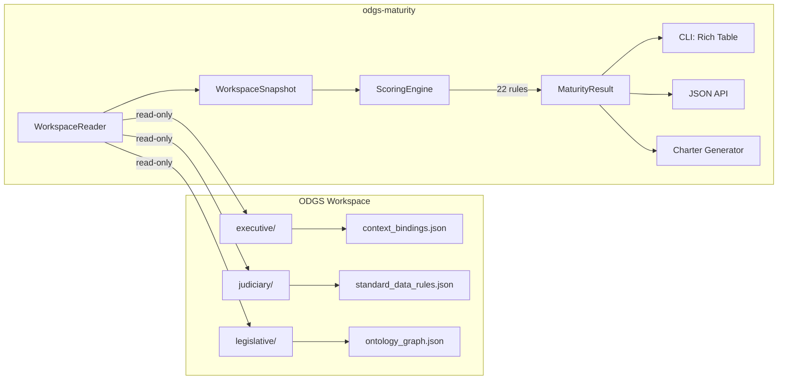

# Open Data Governance Standard (ODGS) — Maturity Assessment

> **Diagnostic scoring and improvement charters for any ODGS workspace.**

[](https://github.com/MetricProvenance/odgs-protocol)
[](https://www.python.org/downloads/)
[](https://github.com/MetricProvenance/odgs-protocol)
[](LICENSE)

---

> **For data engineers:** See [Quick Start](#quick-start) below.
> **For governance leads:** This tool measures *how well* your governance workspace is configured — not just whether files exist.
> **For platform operators:** The JSON output (`--json`) integrates directly with your governance dashboarding or CI/CD pipeline.

---

> [!IMPORTANT]
> **This is a diagnostic tool, not a data processor.** `odgs-maturity` performs a read-only analysis of your ODGS workspace artifacts. It never modifies your governance configuration, connects to external services, or touches production data.

---

## The Problem

`odgs conformance` answers: _"Do the required files exist?"_ — always 100% for a valid install.

That tells you nothing about *readiness*.

A fresh ODGS workspace ships with 50 generic rules, 14 context bindings, and 60+ data quality dimensions — but zero bridges connected, no regulation packs installed, all owners set to `TBD`, and no workspace identity configured. Your governance engine is structurally complete but operationally inert.

**`odgs-maturity` answers the real question: _"How production-ready is this governance deployment?"_**

---

## Quick Start

```bash
pip install odgs-maturity
```

### Score Your Workspace

```bash
# Auto-detect workspace in current directory
odgs-maturity score

# Point at a specific workspace
odgs-maturity score --workspace /path/to/odgs-project

# Machine-readable output for API / CI integration
odgs-maturity score --workspace ./my-project --json
```

### Example Output

```
╭───────────────────────────── Assessment ─────────────────────────────╮
│   ODGS Governance Maturity Score                                     │
│                                                                      │
│   ███████████████░░░░░░░░░░░░░░░  52.6%  (Defined)                   │
│                                                                      │
╰──────────────────────────────────────────────────────────────────────╯
                       Pillar Breakdown
┏━━━━━━━━━━━━━━━━━━━━━━━━━┳━━━━━━━━┳━━━━━━━━━━━━┳━━━━━━┳━━━━━━┓
┃ Pillar                  ┃  Score ┃ Level      ┃ Gaps ┃ Flag ┃
┡━━━━━━━━━━━━━━━━━━━━━━━━━╇━━━━━━━━╇━━━━━━━━━━━━╇━━━━━━╇━━━━━━┩
│ Governance Foundations  │  66.7% │ Measured   │    1 │ 🟡   │
│ Quality Enforcement     │  38.7% │ Developing │    2 │ 🔴   │
│ Operational Readiness   │  83.3% │ Optimised  │    1 │ 🟢   │
│ Metadata Integrity      │  36.7% │ Developing │    2 │ 🔴   │
│ Usage & Analytics       │ 100.0% │ Optimised  │    0 │ 🟢   │
│ Organisational Adoption │  61.3% │ Measured   │    2 │ 🟡   │
│ Certification & Trust   │   0.0% │ Initial    │    2 │ 🔴   │
│ Bridge Connectivity     │   0.0% │ Initial    │    2 │ 🔴   │
└─────────────────────────┴────────┴────────────┴──────┴──────┘

⚠ 3 critical gap(s):
  • Data Rules With Logic: Add logic_expression to rules for automated enforcement
  • Rule Owner Assignment: Assign data stewards as rule owners
  • Physical Data Map Coverage: Register all source-of-record systems

21 rules evaluated, 12 gaps found
```

> The output above is from a real ODGS v6.0.2 workspace with default configuration — no bridges, no packs, no workspace identity.

---

## The 8-Pillar Maturity Model

The assessment framework adapts 6 knowledge areas from **ISO/IEC 38505-1** (Governance of Data) and **ISO/IEC 25012** (Data Quality Model) and adds 2 pillars native to the ODGS protocol.

| # | Pillar | Source | Weight | What It Measures |
|:--|:---|:---|:---|:---|
| 1 | **Governance Foundations** | ISO 38505 / 25012 | 20% | Context bindings, process governance maps, workspace identity |
| 2 | **Quality Enforcement** | ISO 38505 / 25012 | 18% | Rules with executable logic, owner assignment, DQ dimensions |
| 3 | **Operational Readiness** | ISO 38505 / 25012 | 15% | Interceptor presence, enforcement mode, SPOT risk factors |
| 4 | **Metadata Integrity** | ISO 38505 / 25012 | 12% | Ontology graph depth, metrics documentation, physical data map |
| 5 | **Usage & Analytics** | ISO 38505 / 25012 | 8% | Metrics count, rules-to-dimensions linkage coverage |
| 6 | **Organisational Adoption** | ISO 38505 / 25012 | 12% | Industry targeting, context-rule binding density, org identity |
| 7 | **Certification & Trust** | ODGS | 8% | Regulation packs installed, cryptographic signature validity |
| 8 | **Bridge Connectivity** | ODGS | 7% | Active bridge configs, connector type diversity |

### Maturity Levels (ISO/IEC 38505-1 & ISO/IEC 25012-aligned)

| Level | Score | Interpretation |
|:---|:---|:---|
| **Initial** | 0–19% | Governance exists in name only. No operational capability. |
| **Developing** | 20–39% | Basic structures present but largely unconfigured. |
| **Defined** | 40–59% | Standard governance in place. Enforcement gaps remain. |
| **Measured** | 60–79% | Quantitative governance. Metrics and ownership assigned. |
| **Optimised** | 80–100% | Continuous improvement. Full enforcement with audit trails. |

---

## Scoring Rules

22 rules evaluate your workspace across the 8 pillars. Each rule produces:

- **Score** (0.0–1.0) — Normalised assessment
- **Evidence** — What the rule inspected
- **Recommendation** — Actionable improvement step
- **Cost Flag** (🔴 RED / 🟡 AMBER / 🟢 GREEN) — Urgency indicator

<details>
<summary><b>Full Rule Reference</b></summary>

| Rule ID | Pillar | What It Checks |
|:---|:---|:---|
| `GOV-01` | Governance Foundations | Context binding count and quality |
| `GOV-02` | Governance Foundations | Process governance maps |
| `GOV-03` | Governance Foundations | Workspace YAML configuration |
| `QE-01` | Quality Enforcement | Rules with `logic_expression` |
| `QE-02` | Quality Enforcement | Rule owner assignment (non-TBD) |
| `QE-03` | Quality Enforcement | DQ dimension coverage |
| `OPS-01` | Operational Readiness | Interceptor module availability |
| `OPS-02` | Operational Readiness | Enforcement mode configuration |
| `OPS-03` | Operational Readiness | SPOT factor completeness |
| `META-01` | Metadata Integrity | Ontology graph node depth |
| `META-02` | Metadata Integrity | Standard metrics with formula |
| `META-03` | Metadata Integrity | Physical data map coverage |
| `USE-01` | Usage & Analytics | Metrics count threshold |
| `USE-02` | Usage & Analytics | Rules-to-DQ dimensions linkage |
| `ORG-01` | Organisational Adoption | Industry code in workspace config |
| `ORG-02` | Organisational Adoption | Context-to-rule binding density |
| `ORG-03` | Organisational Adoption | Organisational identity in config |
| `BRG-01` | Bridge Connectivity | Bridge configuration files present |
| `BRG-02` | Bridge Connectivity | Connector type diversity |
| `CERT-01` | Certification & Trust | Regulation packs installed |
| `CERT-02` | Certification & Trust | Pack signature verification |
| *Reserved* | — | Extensible via `@_register` decorator |

</details>

---

## JSON API Output

For CI pipelines, dashboards, or the ODGS OS kernel:

```bash
odgs-maturity score --workspace ./my-project --json
```

```json
{
  "aggregate_score": 52.6,
  "level": "Defined",
  "level_value": 3,
  "total_rules": 21,
  "total_gaps": 12,
  "red_flags": 3,
  "amber_flags": 8,
  "pillars": {
    "governance_foundations": {
      "name": "Governance Foundations",
      "score": 66.7,
      "level": "Measured",
      "weight": 0.20,
      "cost_flag": "amber",
      "rules_evaluated": 3,
      "gaps": 1,
      "rules": [ ... ]
    }
  }
}
```

---

## Programmatic Usage

```python
from odgs_maturity.workspace.reader import WorkspaceReader
from odgs_maturity.scoring.engine import score_workspace

# Read workspace artifacts (read-only)
reader = WorkspaceReader()
snapshot = reader.read("/path/to/odgs-project")

# Run assessment
result = score_workspace(snapshot)

# Use the result
print(f"Score: {result.aggregate_score}%")  # 52.6
print(f"Level: {result.level.label}")        # "Defined"
print(f"Gaps:  {result.total_gaps}")         # 12

# Per-pillar access
for pillar, pr in result.pillars.items():
    print(f"  {pillar.display_name}: {pr.score}%")

# Serialise for API consumers
import json
json.dumps(result.to_dict())
```

---

## ODGS Ecosystem

`odgs-maturity` is part of the Open Data Governance Standard ecosystem. It inspects workspaces created by the core `odgs` package and integrates with the full bridge infrastructure.

```
┌──────────────────────────────────────────────────────────────────────┐
│                        ODGS Ecosystem                                │
│                                                                      │
│  ┌──────────────┐  ┌─────────────────┐                               │
│  │  odgs (core)  │  │  odgs-maturity   │                              │
│  │  Engine +     │◀─│  Score + Charter │                              │
│  │  Interceptor  │  │  22 rules        │                              │
│  └──────┬───────┘  └─────────────────┘                               │
│         │                                                            │
│  ┌──────┴───────────────────────────────────────────────────────┐    │
│  │                     Platform Bridges                          │    │
│  │  odgs-mcp-server · odgs-llm-bridge · odgs-flint-bridge       │    │
│  │  odgs-collibra-bridge · odgs-databricks-bridge               │    │
│  │  odgs-snowflake-bridge                                        │    │
│  └───────────────────────────────────────────────────────────────┘    │
└──────────────────────────────────────────────────────────────────────┘
```

| Package | Role | Link |
|:---|:---|:---|
| [`odgs`](https://pypi.org/project/odgs/) | Core validation engine, interceptor, and rule evaluation | [](https://pypi.org/project/odgs/) |
| **`odgs-maturity`** | **Diagnostic scoring and improvement charters** *(this package)* | [](https://pypi.org/project/odgs-maturity/) |
| [`odgs-mcp-server`](https://pypi.org/project/odgs-mcp-server/) | AI agent integration (Claude, Cursor, Copilot) via MCP | [](https://pypi.org/project/odgs-mcp-server/) |
| [`odgs-llm-bridge`](https://pypi.org/project/odgs-llm-bridge/) | Compile regulations into enforceable rules via LLM | [](https://pypi.org/project/odgs-llm-bridge/) |
| [`odgs-flint-bridge`](https://pypi.org/project/odgs-flint-bridge/) | TNO FLINT legislative semantics ingestion | [](https://pypi.org/project/odgs-flint-bridge/) |
| [`odgs-collibra-bridge`](https://pypi.org/project/odgs-collibra-bridge/) | Collibra Business Glossary sync | [](https://pypi.org/project/odgs-collibra-bridge/) |
| [`odgs-databricks-bridge`](https://pypi.org/project/odgs-databricks-bridge/) | Databricks Unity Catalog integration | [](https://pypi.org/project/odgs-databricks-bridge/) |
| [`odgs-snowflake-bridge`](https://pypi.org/project/odgs-snowflake-bridge/) | Snowflake Data Dictionary integration | [](https://pypi.org/project/odgs-snowflake-bridge/) |

---

## How Maturity Drives the Ecosystem

The maturity score is not a vanity metric. It is the **primary diagnostic signal** that connects the free-tier ODGS install to the commercial governance infrastructure:

```
odgs init → odgs-maturity score → gaps identified → bridges + packs resolve gaps → score improves
```

| Score Range | What It Means | Typical Next Step |
|:---|:---|:---|
| **0–30%** | Fresh install, nothing configured | Run `odgs init`, set workspace identity |
| **30–50%** | Rules exist but no enforcement | Connect bridges, assign rule owners |
| **50–70%** | Operational but uncertified | Install regulation packs, verify signatures |
| **70–85%** | Production-ready, gaps in audit | Configure webhook events, bridge diversity |
| **85–100%** | Full sovereign governance | Continuous improvement cycle via charter |

---

## Improvement Charters

Turn gaps into action plans. The charter generator transforms your maturity score into a structured **ISO/IEC 38505-1 & ISO/IEC 25012-aligned improvement charter** — complete with root cause analysis, strategic alignment, and recommended action items.

```bash
# Interactive — guided prompts for business context
odgs-maturity charter --workspace ./my-project

# Non-interactive — defaults for CI/CD
odgs-maturity charter --workspace ./my-project --non-interactive --output charter.md

# JSON export for programmatic consumption
odgs-maturity charter --workspace ./my-project --non-interactive --json > charter.json
```

### Three Charter Types

| Type | Template | Sections | Use Case |
|:---|:---|:---|:---|
| **Lifecycle Pain Point** | 8 sections (A–H) | Business case, problem statement, goals, scope, dimensions, actions, KPIs, next steps | A specific business process stage has data quality issues |
| **KPI Improvement** | 3 sections (A–C) | KPI analysis, root causes, improvement recommendations | A KPI's reliability needs to improve |
| **Strategic / AI Initiative** | 2 sections (A–B) | Data readiness assessment, AI foundation requirements | Preparing for a strategic programme or AI deployment |

### What's in a Charter

Every generated charter includes:

- **SPOT Root Cause Analysis** — Gaps classified as Standard / Process / Organisation / Technology
- **ISO/IEC 25012 Dimension Mapping** — The specific data quality dimensions (from 60 ISO/IEC 25012 & ISO 8000-8 dimensions) most affected by your gaps
- **Strategic Alignment** — Auto-matched strategic objective from 8 universal governance goals
- **Cost/Risk Flags** — Critical indicators requiring immediate attention
- **Actionable Sections** — Each section contains populated recommendations, not just templates

### Programmatic Usage

```python
from odgs_maturity.workspace.reader import WorkspaceReader
from odgs_maturity.scoring.engine import score_workspace
from odgs_maturity.charter.generator import generate_charter
from odgs_maturity.charter.models import CharterType
from odgs_maturity.charter.export import to_markdown, to_json

# Score the workspace
reader = WorkspaceReader()
snapshot = reader.read("/path/to/odgs-project")
result = score_workspace(snapshot)

# Generate a charter
charter = generate_charter(
    result,
    CharterType.LIFECYCLE_PAIN_POINT,
    lifecycle_name="Order to Cash (O2C)",
    stage_name="Invoice Processing",
    pain_points=["Duplicate entries", "Missing PO references"],
)

# Export
markdown = to_markdown(charter)
json_str = to_json(charter)
```

---

## Architecture

`odgs-maturity` is designed as a **read-only diagnostic layer**. It never imports from or modifies the core `odgs` package at runtime.



---

## Extending the Rule Set

Adding new rules is trivial. Define a function with the `@_register` decorator:

```python
# In scoring/rules.py
@_register("CUSTOM-01", "My Custom Check", Pillar.GOVERNANCE_FOUNDATIONS)
def _custom_check(snap: WorkspaceSnapshot) -> RuleResult:
    # Your logic here
    return RuleResult(
        rule_id="CUSTOM-01",
        rule_name="My Custom Check",
        pillar=Pillar.GOVERNANCE_FOUNDATIONS,
        score=0.8,
        max_score=1.0,
        evidence="Found 4 of 5 required items",
        recommendation="Add the missing governance artefact",
        cost_flag=CostFlag.AMBER,
    )
```

The engine automatically discovers all registered rules at import time.

---

## Requirements

- **Python:** 3.9+
- **Dependencies:** `typer`, `rich`, `pydantic`, `pyyaml` (all lightweight, no ML/GPU)
- **Optional:** `weasyprint` for PDF charter export (`pip install odgs-maturity[pdf]`)
- **ODGS workspace:** Any workspace created by `odgs init` (v5.x or v6.x)

---

## About ODGS

The **Open Data Governance Standard** is a sovereign enforcement protocol that validates data operations against governance rules at runtime. It produces cryptographic S-Certs (Sovereign Certificates) — machine-verifiable proof that governance rules were evaluated before data entered a pipeline.

- [ODGS on PyPI](https://pypi.org/project/odgs/)
- [Documentation](https://github.com/MetricProvenance/odgs-protocol)
- [Research Paper (SSRN)](https://papers.ssrn.com/abstract=6205478)

---

## License

Released under the **Apache 2.0 License**.

> * **No Vendor Lock-in.**
> * **No Cloud Dependency.**
> * **100% Data Sovereignty.**

---

ODGS Maturity | Part of the [Open Data Governance Standard](https://github.com/MetricProvenance/odgs-protocol) | Developed by [Metric Provenance](https://metricprovenance.com) | The Hague, NL 🇳🇱
